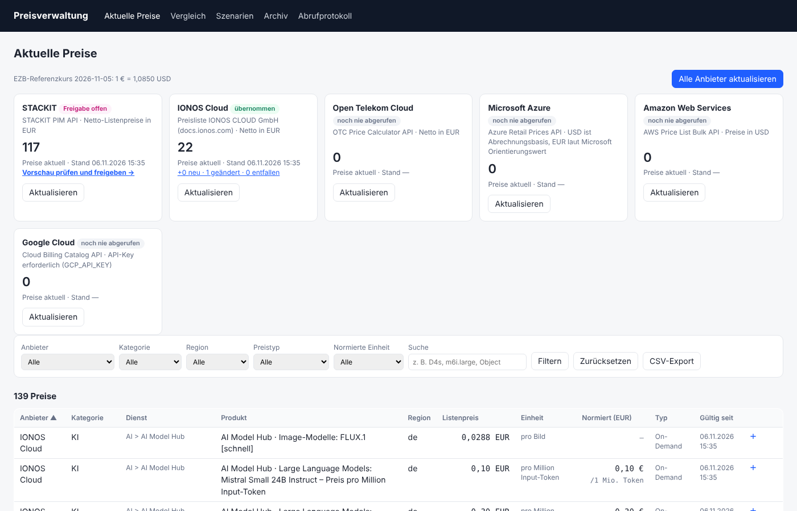

# price_management – Preisverwaltung für Cloud-Listenpreise

Fragt auf Knopfdruck die **öffentlichen Listenpreise** von **STACKIT, IONOS Cloud, Open Telekom Cloud,
Microsoft Azure, AWS und Google Cloud** ab und zeigt immer den neuesten Stand an. Ältere Preise wandern
automatisch ins **Archiv**. Das Archiv ist nur auf Anforderung sichtbar, über den Menüpunkt „Archiv“ oder den
Verlauf eines einzelnen Preises.



Funktionen:

- **Abruf je Anbieter oder für alle Anbieter auf einmal.** Ergebnisse kommen zuerst in eine **Vorschau**
  und werden nach Prüfung übernommen. Der aktuelle Bestand ändert sich bis zur Übernahme nicht.
- **Schutzregeln:** Teilausfälle, leere Bereiche, Massen-Entfall und Währungswechsel führen nie automatisch
  zu Archivierungen.
- **Normalisierung** auf EUR (EZB-Referenzkurs) und auf €/Monat, €/GB-Monat, €/GB usw.
  Daneben gibt es eine einheitliche Einteilung der Preistypen.
- **VM-Vergleich** über alle Anbieter (vCPU/RAM → günstigste Option in €/Monat).
- **Szenarien (Warenkorb)** mit Varianten. Damit lassen sich ganze Plattformen über mehrere Anbieter hinweg vergleichen.
- **Preisverlauf** je Produkt, **Änderungsansicht** je Abruf, **CSV-Exporte**.
- Optional: **Benachrichtigung** per Webhook (Teams/Slack/Mattermost) oder E-Mail sowie ein **täglicher Zeitplan**.
- Die App nutzt **nur die Python-Standardbibliothek**, speichert in **SQLite** und läuft im Docker-Container.

## Schnellstart (Docker)

```bash
cp .env.example .env          # PV_USER/PV_PASSWORD setzen, optional GCP_API_KEY
docker compose up -d --build
# -> http://<server>:8080
```

Danach in der Oberfläche **„Alle Anbieter aktualisieren“** klicken. Der erste Abruf eines Anbieters wird
direkt übernommen. Spätere Abrufe mit Änderungen erscheinen als **„Vorschau prüfen und freigeben“**.

Vor dem Produktivbetrieb bitte den **Go-Live-Test** in [docs/BETRIEB.md](docs/BETRIEB.md#go-live-test) durchführen.
Die Anbieter-Schnittstellen konnten bei der Entwicklung nicht live getestet werden, siehe [docs/ANBIETER.md](docs/ANBIETER.md).

## Ohne Docker

Voraussetzung ist Python 3.11 oder neuer.

```bash
python3 -m app serve                         # Web-Oberfläche (Port 8080)
python3 -m app refresh all                   # alle Anbieter abrufen
python3 -m app refresh stackit --uebernehmen # ohne Vorschau übernehmen (Schutzregeln gelten)
python3 -m app freigeben 42                  # Vorschau von Abruf 42 übernehmen
python3 -m app backup /backup/preise.db      # konsistente Sicherung
python3 -m app kurse                         # EZB-Kurse laden, Normierung neu berechnen
```

Beispieldaten ohne Internetzugang lassen sich so erzeugen und anzeigen:

```bash
python3 scripts/beispieldaten.py data/beispiel
PV_DB=data/beispiel/preise_beispiel.db python3 -m app serve
```

## Dokumentation

| Dokument | Inhalt |
|---|---|
| [docs/KONZEPT.md](docs/KONZEPT.md) | Architektur, Datenmodell, Abgleich/Archiv, Vorschau, Schutzregeln, Normalisierung, Vergleich, Szenarien |
| [docs/ANBIETER.md](docs/ANBIETER.md) | Quellen je Anbieter, Abrufumfang, bekannte Risiken, Prüfhinweise |
| [docs/BETRIEB.md](docs/BETRIEB.md) | Installation, Konfiguration, Reverse-Proxy, Sicherung, Monitoring, Benachrichtigung, Go-Live-Test |
| [docs/REVIEW.md](docs/REVIEW.md) | Unabhängiges Review (Claude Fable) und Umsetzungsstand je Befund |
| [CHANGELOG.md](CHANGELOG.md) | Versionshistorie |
| [data/beispiel/](data/beispiel/) | Beispiel-Datenbank und CSV-Exporte (aus Testdaten, **nicht aktuell**) |

## Tests

```bash
python3 -m unittest discover -s tests -t .
```

Die 58 Tests laufen ohne Netzwerk. Abgedeckt sind:

- Abgleich und Schutzregeln
- Teilausfälle und Umbenennungen
- Datenbank-Migration
- alle Abruf-Module, darunter HTML-Tabellen bei IONOS, Paging bei Azure und OTC sowie gzip bei AWS
- Normalisierung und EZB-Kurse
- Vorschau und Freigabe, Sperren und Hintergrundprozess
- Web-Oberfläche einschließlich Anmeldung, CSRF, CSV-Injektion und Szenarien
- Benachrichtigung und Archiv-Aufbewahrung
